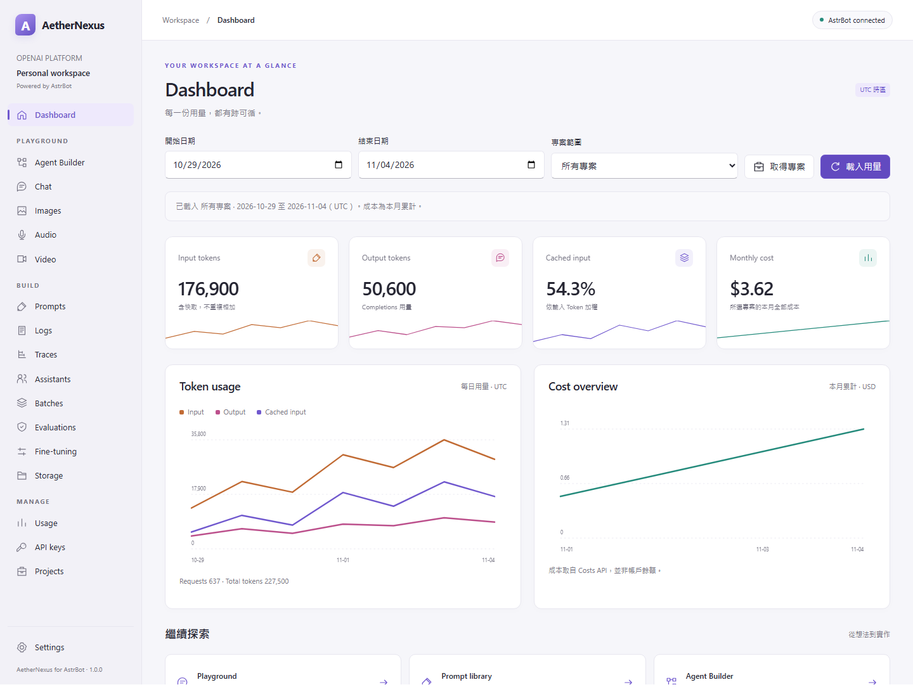

# AetherNexus for AstrBot

**以 Fluent 風格 WebUI，在 AstrBot 中管理 OpenAI Platform。**


AetherNexus for AstrBot 將 [AetherNexus](https://github.com/Eternity-boundary/AetherNexus) 的 WinUI 3／C++ 工作區移植為 AstrBot 外掛，以 Python 後端與 HTML／CSS／JavaScript 介面，整合用量檢視、模型實驗和組織管理。

WebUI 支援淺色、深色、跟隨 AstrBot 主題與窄螢幕導覽。一般使用不需要 Windows 原生執行環境、Wasm、Node.js 或額外的前端建置。

[快速開始](#快速開始) · [功能](#功能) · [遷移指南](#遷移指南) · [與桌面版的差異](#與桌面版的差異) · [開發與測試](#開發與測試) · [文件](#文件)

## 功能

| 工作區 | 能做什麼 |
| --- | --- |
| **Dashboard** | UTC 日期與專案篩選、Token／請求數／加權快取比例、本月成本與趨勢圖，以及設定頁中的本機預算參考值。可啟用 `/用量`，重新整理全部資料後回覆原會話；各資料區塊分別處理錯誤。 |
| **Playground** | Chat 多輪訊息、Responses SSE、停止等待、圖片／PDF 附件與 Python 範例；Images 生成／參考圖編輯；Audio Realtime、轉錄與相容模式；本機 Agent Builder 工作流程與 Video 分鏡／既有影片預覽。 |
| **BUILD** | 本機 Prompt 版本與變數、Responses 測試、Stored Chat logs、已知 ID 的 Responses、Agent traces 與 OTLP span 階層、批次、微調及 Files／向量庫管理。 |
| **遷移工作台** | Assistants 設定轉為本機 Prompt；Evals 既有結果唯讀檢視、匯出與本機 JSON 開啟。 |
| **MANAGE** | Usage 分類／分組／趨勢與 CSV 匯出、Admin／專案 API keys 目錄、權杖簽發與撤銷、專案成員及模型速率限制。 |
| **設定** | 跟隨 AstrBot／淺色／深色主題、一般 API Key／Admin Key 分槽設定、本機每月 USD 預算參考值，以及 `/用量` 指令開關。 |

功能依公開 API、帳戶資格與權杖權限提供。BUILD／MANAGE 以操作表單與進階 JSON 提供服務；清單搜尋僅篩選已載入項目，「載入更多」逐頁取得資料。

Logs 只列出已儲存的 Chat Completions，Response 需以已知 ID 查詢。Video 不呼叫已停用的生成 API；Agent Builder 是本機工作流程，不提供官方託管工作流程的發布或同步。



## 快速開始

### 1. 準備 AstrBot 環境

- **AstrBot 4.29.4 或更新的 4.x 版本**，具備 `astrbot.api.web`、可視化視圖、bridge 與 SSE 能力；版本範圍以 [metadata.yaml](metadata.yaml) 為準。
- 使用符合 AstrBot 要求的 Python 環境；目前 AstrBot 專案要求 Python 3.12 以上。
- 執行期依賴聲明於 [requirements.txt](requirements.txt)，由 AstrBot 的外掛依賴機制安裝。

外掛沿用 AstrBot 的登入驗證與 API 服務，不另外監聽連接埠。直接開啟 `index.html` 無法使用工作區。

### 2. 安裝與開啟

將完整外掛目錄放入 AstrBot：

```text
AstrBot/
  data/
    plugins/
      aethernexus_for_astrbot/
        main.py
        metadata.yaml
        requirements.txt
        views/workspace/index.html
```

也可在 AstrBot 的外掛管理頁上傳已打包的 ZIP。安裝後重載外掛，再開啟：

**AstrBot WebUI → 外掛 → AetherNexus → 可視化視圖 → AetherNexus**

聊天指令 `/aethernexus` 會回覆工作區入口說明。開啟工作區不會自動呼叫 OpenAI；遠端查詢與操作由明確點擊，或啟用後的 `/用量` 指令觸發。

### 3. 設定權杖

開啟工作區的 **Settings → Credentials**，設定需要的權杖，或使用 AstrBot 伺服器上的環境變數：

| 權杖 | 預設環境變數 | 使用範圍 |
| --- | --- | --- |
| 一般 API Key | `OPENAI_API_KEY` | 模型生成、Playground 與 BUILD；操作範圍取決於其專案與權限。 |
| Admin Key | `OPENAI_ADMIN_KEY` | Dashboard 的組織用量／成本，以及 MANAGE 組織管理 API。 |

Admin Key 不替代一般模型權杖。外掛配置中的 `api_key_env`／`admin_key_env` 填寫的是**環境變數名稱**，不是權杖值；權杖值只在執行遠端操作時讀取。

在 Settings 輸入的權杖僅保存於外掛程序記憶體，重載／卸載後清除，不回填、不寫入資料庫。清除槽會停用該程序對應槽的環境變數後備；選擇「使用環境變數」可恢復讀取伺服器環境。設定操作不會自動驗證權杖，也不會建立新 Key。

### 4. 啟用 `/用量` 指令（選用）

在 **Settings → 消息指令** 開啟「**啟用 /用量 指令**」，按「**儲存指令設定**」後立即生效。預設關閉；開關保存於本機資料庫，重載後保留。

在 AstrBot 會話傳送 `/用量`，會重新取得 **所有專案近 7 天（含今日）的 UTC 用量、本月累計成本、每日趨勢、完整專案清單（含已封存）與本機預算參考值**，再透過 AstrBot 消息管線分段回覆，每段最多 3000 字元。每次執行均重新查詢，不以舊報告代替；各區塊若失敗會列出錯誤，其他成功資料仍可回覆。

未加入 Admin Key 時，指令只回覆前往 **Settings → Credentials** 加入權杖的提示，不呼叫遠端 API。指令會回覆至發出指令的原會話，包含群組；啟用前請確認該會話適合顯示組織用量、成本與專案名稱。

已開啟且篩選範圍相同的 Dashboard 會在 5 秒內同步最新報告；篩選不同時保留原範圍並顯示提示。同步只讀取伺服器記憶體中的指令報告，不額外呼叫 OpenAI；報告於外掛卸載／重載後清除。


## 遷移指南

外掛保留 WinUI 3 版各頁的遷移指南與棄用提示：**Prompts、Assistants、Evaluations、Fine-tuning、Agent Builder、Audio、Video、Images、Chat** 共 9 頁，均在**標題下方**提供「遷移指南 · 狀態／日期」按鈕及影響說明。

按下按鈕可在本機對話框閱讀影響範圍、原版三個遷移步驟、文件核對日期（2026-11-05）及各頁對應的官方文件連結。開啟／關閉指南不會讀取權杖、發起 API 呼叫、上傳資料或改變草稿與設定；模型測試需另行明確執行。Audio 切換到 Speech 或英文翻譯時，也會保留該模式的棄用提示。

| 頁面 | 需要留意的變動 |
| --- | --- |
| **Prompts** | 官方可重用 Prompt 物件預定 2026-11-30 停用；外掛使用本機版本庫，保存 instructions／input，再呼叫 Responses 測試。 |
| **Evaluations** | 只查詢既有 eval、run 與 output items；程式於 2026-11-30 起停止遠端讀取，本機 JSON 仍可開啟與匯出。 |
| **Agent Builder** | 官方託管產品預定 2026-11-30 停用；外掛的本機節點流程與 JSON／Agents SDK Python 匯出不依賴該產品。 |
| **Fine-tuning** | 程式於 2027-01-06 起停止建立新工作；既有工作的查閱、事件、checkpoints 與取消操作保留。建立資格與模型支援由伺服器判定。 |
| **Assistants** | 不呼叫舊 Assistants API；匯入既有 Assistant JSON 的名稱、模型與 instructions，轉為本機 Prompt。工具、工具資源及歷史對話不會自動遷移。 |
| **Video** | 不呼叫 Videos API；提供本機分鏡 JSON 與既有影片預覽。 |
| **Audio** | Realtime 為逐次送出、完成後播放；Speech 相容模式於 2027-01-06 起停止，舊英文翻譯於 2027-02-26 起停止。 |
| **Chat／Images** | 頁面本身保留；部分舊模型將停用，須以完整模型 ID 核對官方清單，並比較替代模型的參數、輸入格式、輸出與成本。 |

時程變動請以 [OpenAI 停用公告](https://developers.openai.com/api/docs/deprecations) 為準。維護相關功能時，需同步核對程式中的日期限制與頁面說明。

## 與桌面版的差異

| 項目 | AstrBot 外掛版本 |
| --- | --- |
| **導覽與介面** | WinUI 頁面改為 Fluent 風格 WebUI，使用 AstrBot 原生視圖與 bridge。原入口對照見 [工作區指南](docs/zh/usage.md)。 |
| **權杖儲存** | 使用伺服器環境變數或程序記憶體，不使用 Windows 認證管理員。 |
| **錄音與播放** | 受限 iframe 不開放麥克風，以本機音檔上傳代替原生錄音。Realtime 音檔須為 24 kHz、單聲道、16-bit PCM WAV，最長 3 分鐘；回覆完成後播放，不提供連續收音或語音打斷。多輪歷史只保留已取得的文字。 |
| **傳輸限制** | 檔案上傳與附件總量上限 25 MiB，下載／API 回應上限 40 MiB；圖片最多 16 張參考圖、10 張輸出。較大的 Files 請使用官方工具。 |
| **文件與流程** | 本機 Prompt 支援最多 100 個 Prompt、各 100 個版本、整個版本庫內容上限 8 MiB。工作流程沿用 version-1 格式，最多 100 個節點、64 個執行步驟；Transform 僅代入 `{{input}}`，不執行自訂程式碼。 |
| **語言** | 工作區內容使用繁體中文與原專案英文術語；視圖入口提供 zh-TW／zh-CN／en-US 中繼資料。 |

## 安全與資料

- 一般 Key 與 Admin Key 分開；Admin Key 不送往模型生成端點。權杖不加入本機資料庫、一般結果或匯出文件。
- 簽發後的完整權杖僅在一次性對話框展示；關閉後從頁面移除。Python／瀏覽器無法保證清除所有秘密的記憶體副本。
- 憑證與工作區由管理此 AstrBot 實例的 Dashboard 使用者共用，不提供獨立租戶隔離。
- 正式傳輸固定使用官方 HTTPS／WSS 端點，保留 TLS 驗證，停用環境代理與重新導向；寫入操作不自動重送，不回傳私人錯誤本文。
- 寫入前顯示內容並要求輸入目標 ID 或操作名稱。網路錯誤或停止等待不代表伺服器工作已取消，也不代表不會計費。
- 偏好與 Prompt 版本保存於 AstrBot 資料目錄下的 `data/plugin_data/astrbot_plugin_aethernexus_for_astrbot/workspace.sqlite3`，與外掛程式碼分開。本機預算使用整數美分，只是參考值，不修改 OpenAI 額度或伺服器預算。
- Prompt 為明文文件。對話、圖片、音訊、流程與分鏡不會自動持久化；處理過程可能留在瀏覽器或伺服器記憶體。Chat 預設 `store=false`，只有明確指定進階參數才改變；Prompt 測試固定 `store=false`。匯出文件可能包含私人輸入、附件與結果。

## 開發與測試

```text
main.py                  AstrBot 生命週期、聊天指令與 bridge API
client.py                非同步 HTTP／SSE／Realtime 傳輸
service.py               工作區操作、用量彙整與生成服務
operations.py            BUILD／MANAGE 操作白名單與政策
storage.py               本機偏好與 Prompt 版本庫
workflow.py              本機流程驗證、執行與 Python 匯出
views/workspace/         WebUI 頁面、樣式與互動元件
.astrbot-plugin/i18n/    外掛與視圖中繼資料
_conf_schema.json        AstrBot 外掛配置結構
metadata.yaml            外掛識別、版本與相容範圍
tests/                   合約測試、虛擬傳輸與隔離 UI 宿主
scripts/                 打包工具
docs/                    工作區指南與畫面
```

後端依循 [AstrBot 外掛開發手冊](https://docs.astrbot.app/dev/star/plugin-new.html)：以 `Star` 載入，透過 `context.register_web_api()` 註冊操作，使用 `astrbot.api.web` 讀取請求與回傳結果。聊天指令依[消息事件手冊](https://docs.astrbot.app/dev/star/guides/listen-message-event.html)使用 `@filter.command("用量")`，依[消息發送手冊](https://docs.astrbot.app/dev/star/guides/send-message.html)透過 `yield event.plain_result(...)` 回覆。前端依循[可視化視圖手冊](https://docs.astrbot.app/dev/star/guides/plugin-pages.html)，使用 `window.AstrBotPluginView` 呼叫 API、上傳／下載及訂閱 SSE，靜態資源採相對路徑。

在具有 AstrBot 依賴的開發環境，於**本外掛目錄**執行：

```powershell
python -m pip install -r requirements-dev.txt
python -m pytest -q
python -m ruff format .
python -m ruff check .
```

測試使用 `httpx.MockTransport`、虛擬 WebSocket、隔離資料庫與外連封鎖；不需要真實權杖，涵蓋實際 AstrBot 公開類別、請求／回應、metadata、視圖探索、初始化／卸載及 SSE 生命週期，以及 `/用量` 的官方指令註冊、開關、缺少權杖、完整分頁、部分失敗與消息分段。

瀏覽器測試使用獨立宿主，分兩個終端執行：

```powershell
# Terminal 1: offline host, bound to 127.0.0.1:8765
python tests/ui_harness.py
```

```powershell
# Terminal 2: browser development dependencies only
pnpm install
pnpm exec playwright install chromium --only-shell
pnpm test:ui
pnpm format:check
```

隔離宿主使用**未修改的 AstrBot bridge SDK**與相同的受限 iframe，注入合成 API 資料；正式外掛沒有假資料模式或失敗後的假成功備援。截圖來自此宿主，不代表真實帳戶用量。離線測試通過不代表已完成真實帳戶或正式 AstrBot 部署驗收；本次移植未呼叫真實 OpenAI API。

打包外掛：

```powershell
python scripts/package_plugin.py
```

產生 `dist/aethernexus_for_astrbot-v1.0.0.zip`，排除 Git、虛擬環境、本機依賴、測試輸出、快取與秘密檔案。Node.js／pnpm 只用於前端開發檢查與瀏覽器測試，正式使用外掛不需要安裝。

## 文件

| 主題 | 文件 |
| --- | --- |
| 工作區操作、桌面版入口對照、畫面與驗證範圍 | [繁體中文指南](docs/zh/usage.md) |
| Installation, workspace mapping and limitations | [English guide](docs/en/usage.md) |
| 版本變更 | [v1.0.0](changelogs/v1.0.0.md) |
| AstrBot 外掛開發 | [開發手冊](https://docs.astrbot.app/dev/star/plugin-new.html)／[可視化視圖](https://docs.astrbot.app/dev/star/guides/plugin-pages.html) |
| WinUI 3 原專案 | [AetherNexus](https://github.com/Eternity-boundary/AetherNexus) |

## 授權與來源

本專案採 **GNU GPL v3**，完整條款見 [LICENSE.txt](LICENSE)；新增程式碼標示 `GPL-3.0-only`。AetherNexus 為獨立開發的用戶端，並非 OpenAI 官方產品。
