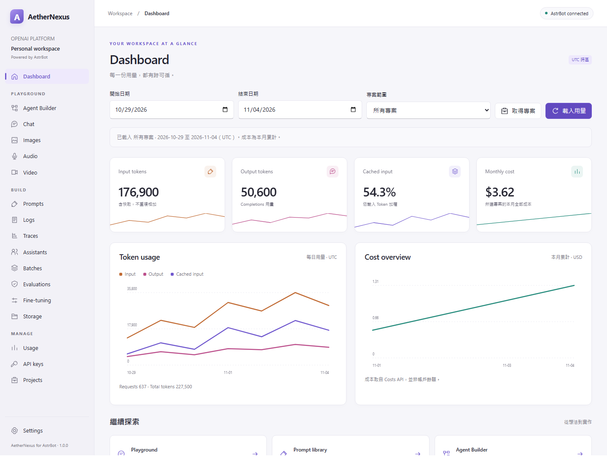
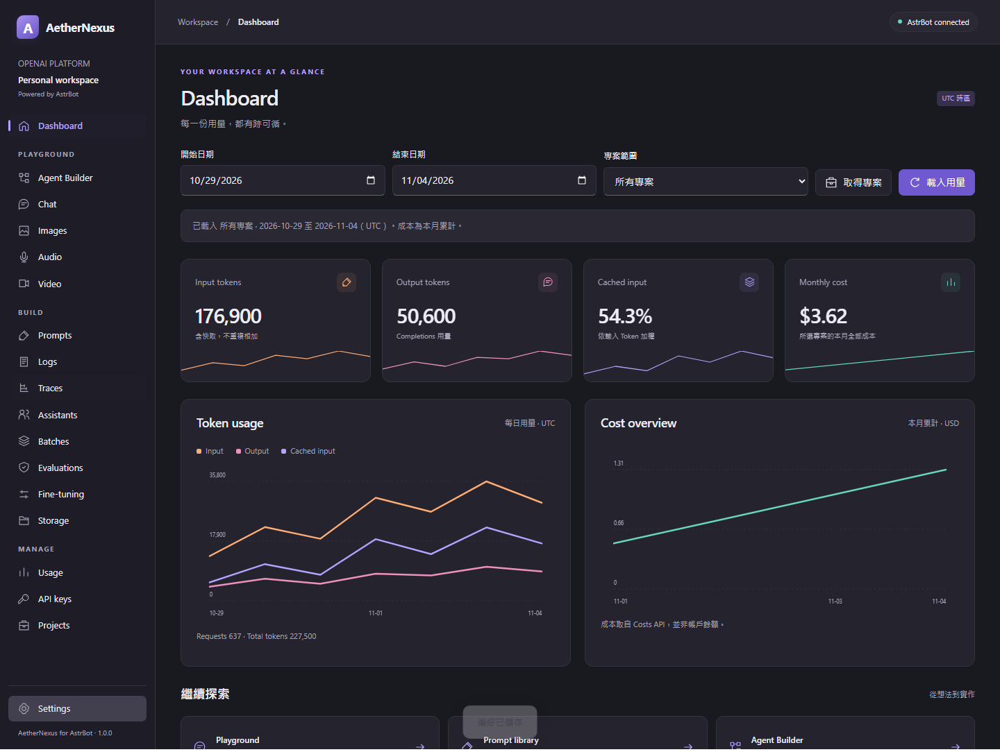
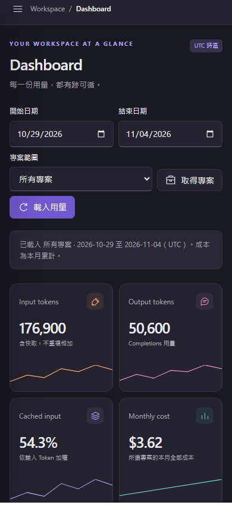

# AetherNexus workspace

Requires AstrBot 4.29.4+ (4.x) with `astrbot.api.web` and plugin views. Open **AstrBot WebUI → Plugins → AetherNexus → Visual views → AetherNexus workspace**. On narrow screens, use the top-left navigation button. The workspace currently uses Traditional Chinese and the original English feature names.

| Original WinUI entry | Plugin entry |
| --- | --- |
| Dashboard | Dashboard: apply UTC dates and an optional project; month-to-date costs use a separate date range. |
| Playground → Chat | Chat: Responses streaming, message editing, parameters, image/PDF attachments, stop, session import/export and Python example. |
| Playground → Images | Images: generation/edits, reference images, preview and original base64 output download. |
| Playground → Audio | Audio: one-turn Realtime, transcription, legacy translation/Speech, playback and WAV download. Upload audio instead of using native recording. |
| Playground → Agent Builder | Agent Builder: local version-1 graph, pointer/keyboard movement, connections, bounded execution, trace and Agents SDK export. |
| Playground → Video | Video: local storyboard and existing video preview. No retired generation API calls. |
| BUILD → Prompts / Assistants | Prompts / Assistants: shared local revision library and legacy Assistant JSON import. Restore history into a draft and save a new revision. |
| BUILD → Logs / Traces | Logs / Traces: choose a public API operation, supply IDs, then query. Select a trace to inspect its OTLP span hierarchy and JSON. |
| BUILD → Batches / Evaluations / Fine-tuning / Storage | Corresponding entry: choose an operation and supply its IDs and JSON body. Child resources are queried explicitly. |
| MANAGE → Usage / API keys / Projects | Corresponding entry: usage reports/CSV, key metadata/issuance/revocation, project membership and model rate limits. |
| Settings | Theme, local USD reference budget, separate general/admin credential slots, and the new `/用量` command switch under 消息指令. |

The original Windows Credential Manager is replaced by server environment variables or process-memory credentials. Set `OPENAI_API_KEY` and `OPENAI_ADMIN_KEY` on the AstrBot server, or enter session-only credentials in Settings. Plugin configuration fields select **environment variable names**, never key values. Keys are not returned by status, persisted in the local database, or included in exports. The Dashboard administrators share this workspace and credentials; it is not a tenant isolation boundary.

Non-secret preferences and prompt revisions live in `data/plugin_data/astrbot_plugin_aethernexus_for_astrbot/workspace.sqlite3`. Dialogs require the exact target ID/action for mutations. POST/DELETE requests are never automatically retried; stopping local waiting does not prove the remote operation stopped.

Runtime assets need no frontend build, CDN or Windows runtime. All authenticated requests use `AstrBotPluginView`, including upload/download and SSE. Uploads use owned, single-use, two-minute tickets to preserve multipart options without bypassing the bridge. Requests go to fixed official HTTPS/WSS endpoints with TLS validation and no redirects/environment proxies. Defaults do not automatically issue model, usage or management requests.

Differences from the desktop version: the restricted iframe does not permit microphone capture; upload audio instead. Realtime playback starts after completion, and uploaded-audio history retains available text only. Uploads/attachments are limited to 25 MiB; responses/downloads to 40 MiB. Management uses inspectable forms and JSON rather than duplicating every native dialog. API retirement gates match the source application; see the [official deprecation page](https://developers.openai.com/api/docs/deprecations).

## `/用量` chat command

Open **Settings → 消息指令**, enable **啟用 /用量 指令**, and click **儲存指令設定**. The switch defaults to off, takes effect immediately after saving, and persists in `workspace.sqlite3` across plugin reloads. Saving theme or budget preferences preserves it.

Send `/用量` in an AstrBot conversation. Each invocation freshly queries all projects' last seven UTC days including today, month-to-date costs, daily token/request/cache and cost trends, the complete project list including archived projects, and the local reference budget. Replies use AstrBot's message pipeline in chunks of at most 3000 characters. A group invocation sends the organization data to that same group.

An **Admin Key** is required. Without one, the command sends a setup hint pointing to **Settings → Credentials** or the server environment and makes no remote requests. A general API key does not substitute for an Admin Key. Usage, costs and projects have independent error states; unavailable values are not reported as zero costs.

An open Dashboard with the same seven-day/all-project scope adopts the new report within five seconds. Different filters are preserved with a notice. This synchronization reads only the existing in-memory report, makes no additional OpenAI requests, and runs only while Dashboard is visible. The report is cleared on plugin unload/reload.

Registration uses `@filter.command("用量")` and replies yield `event.plain_result(...)`, following the official [message event](https://docs.astrbot.app/dev/star/guides/listen-message-event.html) and [message sending](https://docs.astrbot.app/dev/star/guides/send-message.html) guides.

## Per-page migration guides

The original WinUI guides are preserved on nine pages: Prompts, Assistants, Evaluations, Fine-tuning, Agent Builder, Audio, Video, Images and Chat. Below each page title, a visible migration button shows its status/date and impact. The local dialog contains the original three steps, the documentation review date (2026-11-05), and the page-specific official migration link. Closing it or pressing Escape returns to the current draft. Opening/closing the guide does not read credentials, call backend APIs, upload data or change settings.

Prompts links to migration from prompt objects; Evaluations to Evals → Promptfoo; Agent Builder and Assistants to their dedicated migration documents. Other guides link to the deprecation page. Audio also preserves the mode-specific Speech (2027-01-06) and English translation (2027-02-26) notices. Existing backend retirement gates continue to apply.

## Screenshots and testing

These screenshots use synthetic data from the isolated test host, not real account usage.

From the plugin directory, install `requirements-dev.txt` into an AstrBot development environment and run `python -m pytest -q`, `python -m ruff format .`, and `python -m ruff check .`. Tests block external connections and inject HTTP/WebSocket substitutes. They also instantiate the plugin using actual AstrBot public types and exercise request binding, lifecycle, uploads and SSE ownership.

For browser checks, run `python tests/ui_harness.py` in one terminal; run `pnpm install`, `pnpm exec playwright install chromium --only-shell`, and `pnpm test:ui` in another. The loopback-only harness uses the **unmodified AstrBot bridge SDK** inside the production-equivalent restricted iframe. Checks include the usage command switch, missing-key hint, report synchronization and preserved filters, plus all nine migration dialogs, their three steps and official links, close/Escape behavior, unchanged drafts, no backend calls, audio notices, and light/dark/mobile layouts. No real keys or paid requests are needed. Real account access and a full production AstrBot reload were not validated.

Build an installable archive with `python scripts/package_plugin.py`. See the [README](../../README.md) for feature coverage and [LICENSE](../../LICENSE) for GPL-3.0-only terms and original attribution.
