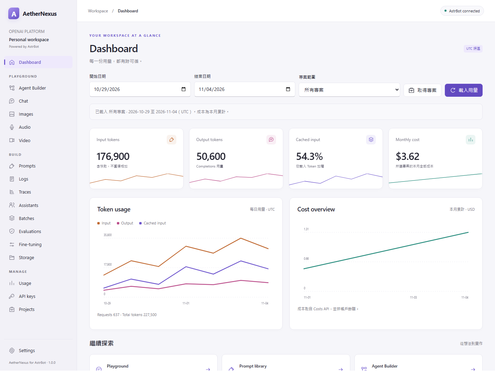
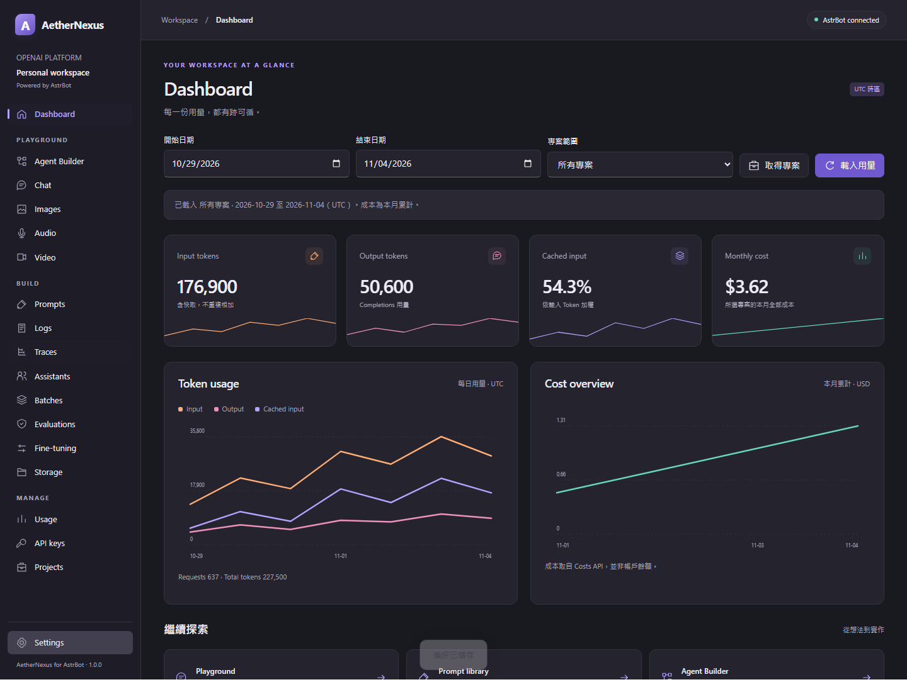
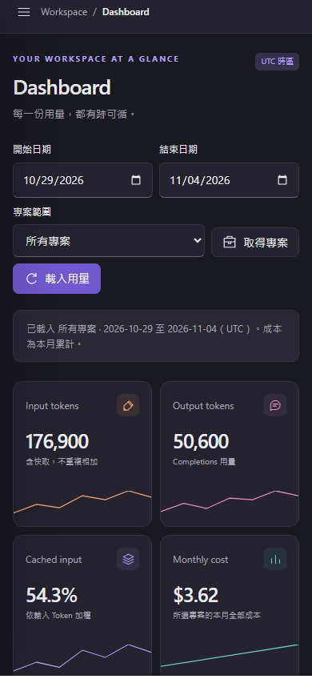

# 工作區入口對照

從 **AstrBot WebUI → 外掛 → AetherNexus → 可視化視圖 → AetherNexus 工作區** 開啟。左側保留原桌面版的工作區分類；窄視窗以左上角按鈕開啟導覽。頁面狀態保留於此瀏覽器視圖，關閉或重新整理後不保留未儲存草稿。

| 原 WinUI 3 入口 | 外掛入口與操作 |
| --- | --- |
| Dashboard | Dashboard → 選擇 UTC 日期、取得專案（選填）、載入用量。成本日期獨立為本月。 |
| Playground → Chat | Chat → 模型 ID／參數／訊息 → 執行；「訊息編輯」可修改多輪角色與內容。 |
| Playground → Images | Images → 提示詞、參考圖與參數 → 生成／編輯圖片。 |
| Playground → Audio | Audio → Realtime／轉錄／翻譯／Speech → 文字或本機音檔 → 送出一次。 |
| Playground → Agent Builder | Agent Builder → 拖曳節點或方向鍵移動；Node properties 設定連線；執行預覽或匯出。 |
| Playground → Video | Video → 本機分鏡／既有影片預覽。生成保持關閉。 |
| BUILD → Prompts | Prompts → 建立或選擇 → 儲存新版本。歷史還原先放入草稿，再另存新版本。 |
| BUILD → Assistants | Assistants → 匯入既有 Assistant JSON → 儲存本機 Prompt。 |
| BUILD → Logs | Logs → 左側選擇 Chat 清單、訊息或 Response ID 操作。 |
| BUILD → Traces | Traces → Agent sessions → Session traces；選定 trace 顯示 OTLP 階層與 JSON。 |
| BUILD → Batches／Evaluations／Fine-tuning／Storage | 同名入口 → 左側選擇操作 → 輸入目標／上層 ID → 執行。子項目不自動查詢。 |
| MANAGE → Usage | Usage → 分類、分組與日期 → 套用；搜尋與顯示不改變完整報告 CSV。 |
| MANAGE → API keys | API keys → 選擇 Admin／專案目錄或操作；專案 Key 需提供 Project ID。 |
| MANAGE → Projects | Projects → 專案、成員或速率限制操作。 |
| 設定 → 主題／預算／權杖 | Settings → 外觀與本機預算；權杖改用伺服器環境或程序記憶體。「消息指令」新增 `/用量` 開關。 |

BUILD／MANAGE 的進階 Query／Body 都使用 JSON。未支援的操作或任意 URL 不會被當成 HTTP 代理。搜尋只針對已載入項目；需要下一頁時按「載入更多」。修改範圍後會清除舊結果；執行期間若改變範圍，過時回應不套用於新範圍。

上傳按鈕會先透過 bridge 建立兩分鐘有效、單次使用且綁定使用者的上傳票證，再傳送檔案，保留用途、模型與 Project ID。下載一律透過 bridge；流程與本機文件則由瀏覽器明確匯出。

## `/用量` 消息指令

前往 **Settings → 消息指令**，勾選「**啟用 /用量 指令**」並按「**儲存指令設定**」。預設關閉，儲存後立即生效；開關寫入 `workspace.sqlite3`，重載後保留。一般外觀／預算儲存不會重設此開關。

啟用後，在 AstrBot 會話傳送 `/用量`。每次執行重新整理所有專案近 7 天（含今日）的 UTC Token、請求數、快取比例與每日趨勢、本月成本與每日趨勢、完整專案清單（含已封存）及本機預算參考值，再經消息管線分段回覆原會話，每段最多 3000 字元。群組指令會將組織用量、成本與專案名稱回覆到該群組。

需要 **Admin Key**；未設定時只提示前往 **Settings → Credentials** 加入權杖或設定伺服器環境變數，不發起遠端查詢。一般 API Key 不能替代 Admin Key。用量、成本與專案清單分別處理失敗；不可用資料顯示錯誤或「—」，不會當成零成本。

當 Dashboard 顯示同樣的近 7 天／所有專案範圍時，5 秒內同步指令的新報告；不同篩選範圍會保留並顯示提示。此同步只讀取伺服器記憶體報告，不重複查詢 OpenAI，且只在 Dashboard 顯示期間運作。報告在外掛卸載／重載後清除。

指令註冊與回覆方式遵循官方[消息事件](https://docs.astrbot.app/dev/star/guides/listen-message-event.html)及[消息發送](https://docs.astrbot.app/dev/star/guides/send-message.html)手冊。

## 各頁遷移指南與棄用提示

Prompts、Assistants、Evaluations、Fine-tuning、Agent Builder、Audio、Video、Images、Chat 共 9 頁，沿用 WinUI 3 版指南。頁面標題下方會直接顯示狀態／日期與影響範圍；點擊「遷移指南」可在本機對話框閱讀三個步驟、文件核對日期（2026-11-05）及各頁對應的官方文件連結。

Prompts 連至雲端 Prompt 物件遷移文件，Evaluations 連至 Evals → Promptfoo，Agent Builder 連至其官方遷移文件，Assistants 連至 Responses／Conversations 遷移文件；其餘頁面連至官方停用公告。開啟指南不會讀取權杖、呼叫 API、自動遷移或改變未儲存的草稿。按「關閉」或 Escape 可返回原頁面。

Audio 選擇 Speech 時，提示 `audio/speech` 與相關模型預定於 2027-01-06 停用；選擇英文翻譯時，提示 `audio/translations` 預定於 2027-02-26 停用、輸出為英文。切回 Realtime／一般轉錄後，該相容模式提示會收起。後端既有的停用日期限制仍會檢查遠端操作。

## 畫面

以下為隔離測試宿主的合成資料，並非真實帳戶用量。

## 驗證範圍

已以實際 AstrBot 公開 API 載入外掛並執行離線合約測試；瀏覽器測試使用官方 bridge 與相同 sandbox，驗證工作區導覽、主題、串流停止、Prompt 版本、流程、圖片預覽、上傳及寫入確認，並檢查 `/用量` 開關、缺少權杖、報告同步與篩選保留，以及 9 頁指南的步驟、官方連結、關閉方式、草稿保留及不發起 API 呼叫。沒有啟動使用者的正式 AstrBot 服務，也未讀取真實秘密或呼叫 OpenAI 服務。部署後仍需依帳戶權限、模型與反向代理設定驗收。
